# Changelog

## v1.3.0 — 2026-11-10

Same cat, same animation, much less work behind it. With the cat running, BetterTouchTool now uses about as much CPU as it does without the cat.

### Results

Measured on an M1 MacBook Pro (macOS 15.7.9, BTT 6.958), Claude in front, nothing playing, on battery. Each run is 60 s; versions were installed and measured in interleaved order, with the Touch Bar kept awake (`caffeinate -u`) so every run saw the same conditions.

| Version | Runs | BetterTouchTool CPU (each run) | Average | BTT wakeups |
|---|---|---|---|---|
| v1.2.0 | 3 | 2.43 · 2.35 · 3.34 % | **2.7 %** | 1.1–1.7 per second |
| Step 1: frames played by Core Animation | 4 | 1.35 · 2.26 · 2.48 · 1.94 % | 2.0 % | 0.0–0.1 per second |
| Step 2 (this release): plus system notifications and spaced-out reads | 3 | 0.69 · 0.69 · 1.69 % | **1.0 %** | 0.1 per second |
| Cat turned off (reference) | 2 | 1.48 · 0.87 % | 1.2 % | 0.1 per second |

- CPU is a percentage of one core. Run-to-run noise in BTT is about ±0.5 points, so the gap between this release and having no cat at all is within noise.
- An 8 s CPU profile of BTT (`sample`) shows the plugin's time on BTT's main thread dropping from 56 samples to 24.
- TouchBarServer, the system process that draws the Touch Bar, stays at 2.3–4.2 % with or without the cat. Its cost depends on whether the Touch Bar is lit (about 0.5 % when it dims), not on the cat.

### What was actually expensive

The obvious suspect was the animation: a 90 ms timer that handed every visible layer a new image 11 times per second. Moving it to Core Animation removed the wakeups but only part of the CPU (step 1 in the table). The profile showed the rest was the once-per-second state check, and in particular three kinds of calls that go to another process:

- **BTT variables.** Every `getVariable` call makes BTT ask macOS, through Accessibility, which app is in front. The plugin made three of these calls per second (`nyan_forzar`, `BTTCurrentlyPlaying`, `BTTCurrentlyPlayingApp`).
- **The frontmost app.** `NSWorkspace.frontmostApplication` and its `bundleIdentifier` are looked up in LaunchServices every time.
- **The battery.** `IOPSCopyPowerSourcesInfo` is a round trip to the power management daemon.

### Changes

**Animation**
- Each layer now receives its whole sprite strip once, decoded up front, and a stepped `contentsRect` keyframe animation shows one frame at a time. Core Animation plays it; the plugin has no per-frame timer anymore.
- All looping animations share the same start time, so accessories stay locked to the cat's bob even when they appear later.
- Layers whose 12 frames are identical (the media button, for example) get no animation at all.
- Only layers that switch between visible and hidden are touched when the mood changes.
- Speed changes keep working without a timer: high CPU (double speed) and idle (slow motion) change the animation's duration; next/previous change the cat's layer speed (2× or −1×, which rewinds) for 8 frames and then restore it.
- One-shot effects (the sparkle burst, the mood-change burst, the button's tap and swipe animations) are single-pass animations that hide themselves when they finish.

**Only the visible cat does any work**
- BTT creates one plugin instance per Touch Bar group (with the Nyan preset, one in Global and one in "Music Playing"). Before, both checked state every second. Now only the instance whose view is on screen does; the others stay idle until they're shown.
- State checks also stop while the screens sleep or you switch to another user account, and resume when you come back.

**Notifications instead of polling**
- The frontmost app arrives with `NSWorkspace.didActivateApplicationNotification`, and its bundle ID and PID are kept until the next switch. Switching apps updates the cat right away instead of on the next tick.
- Battery level and charging state arrive with an IOKit power-source notification.
- Network status already came from `NWPathMonitor`.

**Fewer reads of what rarely changes**
- `nyan_forzar`, `apps.json` and the triple-tap dismissals are read every 5 s instead of every second. Forced states and edited app lists can take up to 5 s to show up.
- `BTTCurrentlyPlayingApp` (whether a paused player is open) is read every 3 s, and only while nothing is playing.
- Still checked every second: whether music is playing (play/pause also updates the button instantly on tap), the microphone, the camera, CPU load, idle time, heat, and the browser tab title when a browser is in front.

### For developers

- `pruebas/`: behavior tests that build the plugin the same way BTT does and exercise it with a fake BTT delegate, fake media keys and a temporary dismissals file. Run `python3 generar.py && zsh pruebas/correr.sh` (42 checks).
- `pruebas/medir-cpu.sh`: the measuring script behind the table above. `zsh pruebas/medir-cpu.sh label 60` records the CPU of BetterTouchTool, TouchBarServer and WindowServer and BTT's wakeups over 60 s, keeping the Touch Bar awake while it runs.

### Upgrading from v1.2.0

1. Replace `~/Library/Application Support/BetterTouchTool/Plugins/NyanCat.swift` with the one from this release and confirm the compile prompt.
2. Restart BTT (hot reload doesn't replace widgets that already exist).

Nothing else changes: same moods, gestures, settings files and widget size.

## v1.2.0 — 2026-10-29

A media button that lives next to the cat, and a clearer note on the one Chile-only mood.

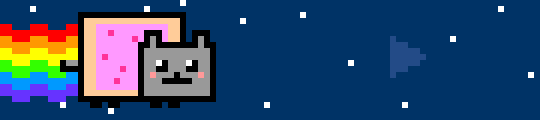

### Media button

- One wide button to the right of the cat, drawn as part of the same pixel scene. The widget grows from 69 to 135 pt (60 pt button with a margin around it).
- Tap for play/pause, swipe right for next track, swipe left for previous. Touches are tracked directly (start position and horizontal travel), so the whole button is the target.
- Each gesture has its own 8-frame animation: the button presses in and swaps ▶/⏸, or the ⏭/⏮ icon shoots off with a rainbow trail while the cat runs at double speed or rewinds. Play/pause flips immediately and reconciles with BTT 2.5 s later.
- No player: a faint outline among the stars, and taps count as taps on the cat. Player open, even paused (`BTTCurrentlyPlayingApp`): the button lights up.
- The panel follows the cat's color scheme: sky, stars, button, accent and rainbow trail switch between navy and yellow, matrix green, and faded along with the cat's base, so it never looks like a separate piece.
- It sends the system media keys (like F7–F9), so it controls whatever macOS considers "now playing".
- Mood changes now play a burst of rainbow pixels that crosses the panel into the cat.
- `nyan_forzar` accepts `reproductor` to preview the lit button while paused.

### About the Chile-only mood

- From September 18 to 19 the cat wears a *chupalla*. Those are Chile's *Fiestas Patrias* (national holidays: Independence Day and the Day of the Army's Glories), and the chupalla is the woven straw hat of the *huaso*, the Chilean countryman, worn at the *fondas* and *cueca* dances those days.
- It's the only mood tied to one country. The plugin reads your Mac's local date, so it shows up on those days wherever you are. If you'd rather not see it, triple-tap the cat and it stays hidden until next year.
- The other special days (Halloween, Christmas on Dec 24–25 and New Year's Eve/Day) and the morning coffee (7–10 AM) also follow your Mac's local date and time.

### Upgrading from v1.1.0

1. Replace `~/Library/Application Support/BetterTouchTool/Plugins/NyanCat.swift` with the one from this release and confirm the compile prompt.
2. Restart BTT (hot reload doesn't replace widgets that already exist).
3. If your preset already shows its own previous / play / next buttons, hide them: the cat's button does the same job in less space.

## v1.1.0 — 2026-10-29

### New moods

| | Mood | Trigger |
|---|---|---|
| 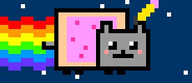 | Pencil behind the ear | A writing or office app in front (Notes, Pages, Word, Obsidian, Notion, Bear…) or a Google Docs tab |
| 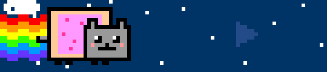 | Speech bubble, typing | A chat app in front (Slack, Discord, WhatsApp, Telegram, Signal, Messages, Teams…) |
| 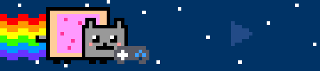 | Gamepad | A game, launcher or emulator in front (Steam, Epic, Battle.net, Minecraft launchers, OpenEmu…) |
| 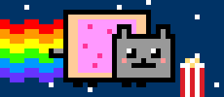 | Popcorn | A video player in front (TV, IINA, VLC, Infuse…) or a YouTube, Netflix or Twitch tab |
| 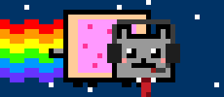 | Tie | Any camera in use, virtual ones included (CoreMediaIO) |
| 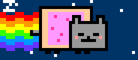 | Falls asleep, slow motion | No keyboard or mouse input for 5 minutes |
|  | Blinking question mark | No network connection |
| 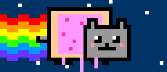 | Melting frosting | The Mac's thermal state is serious or critical |
| 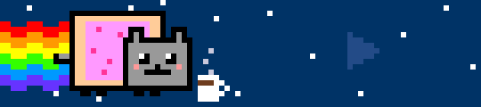 | Steaming coffee | 7 to 10 AM |
| 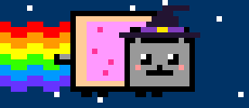 | Witch hat | October 31 |
| 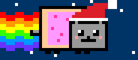 | Santa hat | December 24–25 |
|  | Party hat and confetti | December 31 – January 1 |
| 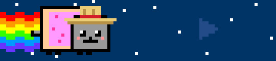 | Chilean *chupalla*, the huaso's straw hat | September 18–19, Chile's *Fiestas Patrias* (see the note in v1.2.0) |

### Triple tap to hide a mood

- Tap the cat three times in a row (within 0.8 s) to hide the decorative moods on screen: coffee, popcorn, chat bubble and special days. The cat answers with a burst of sparkles.
- A hidden mood stays hidden until its next occurrence: coffee until tomorrow morning, a special day until next year, popcorn and the bubble until the next time you open a video or chat app.
- Another triple tap with nothing left to hide brings everything back.
- Moods that carry information (battery, charging, CPU, heat, network, microphone, camera) can't be hidden.
- Dismissals are saved to `~/Library/Application Support/NyanCat/descartados.json`. Every cat widget shares them (BTT creates one instance per Touch Bar group, e.g. Global and "Music Playing"), and they survive a BTT restart.

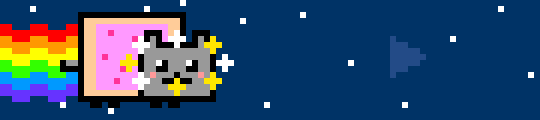

### Haptic feedback

- Each tap on the cat gives a light click on the trackpad, and the triple tap a strong one.
- The Touch Bar has no haptic engine, and the public macOS haptics API only fires while a finger rests on the trackpad. The plugin uses the trackpad actuator through the private MultitouchSupport framework instead, the same approach as [HapticKey](https://github.com/niw/HapticKey). If a macOS update changes that API, the cat keeps working without haptics.

### App lists moved to `apps.json`

- 194 apps across six moods (terminal 58, design 32, writing 37, chat 28, games 25, video 14), picked from the most installed Homebrew casks of the last 365 days, plus popular App Store apps.
- Entries are exact bundle IDs, or a prefix ending in `*` (`com.jetbrains.*`, `com.adobe.PremierePro*`).
- Browser tabs count too: when a browser is in front, the title of its active window is matched against keywords (Penpot, Figma, Canva, Google Docs, YouTube, Netflix, Twitch…). This uses BTT's existing Accessibility permission.
- To customize, copy `apps.json` to `~/Library/Application Support/NyanCat/apps.json`. The plugin reloads it on save, with no BTT restart. Without that file, the copy embedded in the plugin is used.
- `generar.py` validates the file (known moods, no duplicates, well-formed IDs) before embedding it.

### Changes

- Accessory stacking is now a table of zones (`zonas` in `NyanCat.swift.in`) instead of nested `if`s. Head: headset > special day > beret > pencil > nightcap. Eyes: shades > closed (night or idle) > tired. In front of the face: gamepad > popcorn > coffee. Top left: zzz > bubble.
- The state check runs on its own one-second timer, separate from the animation timer, so the animation can slow down (idle) or speed up (high CPU) without affecting detection.
- With everything running, BetterTouchTool still sits at about 2 % CPU on an M1 MacBook Pro.

### Upgrading from v1.0.0

1. Replace `~/Library/Application Support/BetterTouchTool/Plugins/NyanCat.swift` with the one from this release and confirm the compile prompt.
2. Restart BTT (hot reload doesn't replace widgets that already exist).
3. Optional: copy `apps.json` to `~/Library/Application Support/NyanCat/` if you want to edit the app lists.

## v1.0.0 — 2026-10-27

First release: animated Nyan Cat Touch Bar widget for BetterTouchTool, with 8 stackable variants (music, terminal/editor, design app, microphone, low battery, charging, late night, high CPU).
