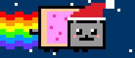
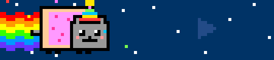
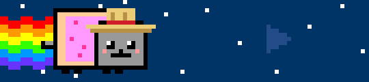

# Changelog

## Unreleased

### Media button

- One wide button to the right of the cat, drawn as part of the same pixel scene. The widget grows from 69 to 135 pt (60 pt button with a margin around it).
- Tap for play/pause, swipe right for next track, swipe left for previous. Touches are tracked directly (start position and horizontal travel), so the whole button is the target.
- Each gesture has its own 8-frame animation: the button presses in and swaps ▶/⏸, or the ⏭/⏮ icon shoots off with a rainbow trail while the cat runs at double speed or rewinds. Play/pause flips immediately and reconciles with BTT 2.5 s later.
- No player: a faint outline among the stars, and taps count as taps on the cat. Player open, even paused (`BTTCurrentlyPlayingApp`): the button lights up.
- The panel follows the cat's color scheme: sky, stars, button, accent and rainbow trail switch between navy and yellow, matrix green, and faded along with the cat's base, so it never looks like a separate piece.
- It sends the system media keys (like F7–F9), so it controls whatever macOS considers "now playing".
- Mood changes now play a burst of rainbow pixels that crosses the panel into the cat.
- `nyan_forzar` accepts `reproductor` to preview the lit button while paused.

## v1.1.0 — 2026-10-29

### New moods

| | Mood | Trigger |
|---|---|---|
|  | Pencil behind the ear | A writing or office app in front (Notes, Pages, Word, Obsidian, Notion, Bear…) or a Google Docs tab |
|  | Speech bubble, typing | A chat app in front (Slack, Discord, WhatsApp, Telegram, Signal, Messages, Teams…) |
|  | Gamepad | A game, launcher or emulator in front (Steam, Epic, Battle.net, Minecraft launchers, OpenEmu…) |
|  | Popcorn | A video player in front (TV, IINA, VLC, Infuse…) or a YouTube, Netflix or Twitch tab |
|  | Tie | Any camera in use, virtual ones included (CoreMediaIO) |
|  | Falls asleep, slow motion | No keyboard or mouse input for 5 minutes |
|  | Blinking question mark | No network connection |
|  | Melting frosting | The Mac's thermal state is serious or critical |
|  | Steaming coffee | 7 to 10 AM |
|  | Witch hat | October 31 |
|  | Santa hat | December 24–25 |
|  | Party hat and confetti | December 31 – January 1 |
|  | Chilean *chupalla* | September 18–19 |

### Triple tap to hide a mood

- Tap the cat three times in a row (within 0.8 s) to hide the decorative moods on screen: coffee, popcorn, chat bubble and special days. The cat answers with a burst of sparkles.
- A hidden mood stays hidden until its next occurrence: coffee until tomorrow morning, a special day until next year, popcorn and the bubble until the next time you open a video or chat app.
- Another triple tap with nothing left to hide brings everything back.
- Moods that carry information (battery, charging, CPU, heat, network, microphone, camera) can't be hidden.
- Dismissals are saved to `~/Library/Application Support/NyanCat/descartados.json`. Every cat widget shares them (BTT creates one instance per Touch Bar group, e.g. Global and "Music Playing"), and they survive a BTT restart.

### Haptic feedback

- Each tap on the cat gives a light click on the trackpad, and the triple tap a strong one.
- The Touch Bar has no haptic engine, and the public macOS haptics API only fires while a finger rests on the trackpad. The plugin uses the trackpad actuator through the private MultitouchSupport framework instead, the same approach as [HapticKey](https://github.com/niw/HapticKey). If a macOS update changes that API, the cat keeps working without haptics.

### App lists moved to `apps.json`

- 194 apps across six moods (terminal 58, design 32, writing 37, chat 28, games 25, video 14), picked from the most installed Homebrew casks of the last 365 days, plus popular App Store apps.
- Entries are exact bundle IDs, or a prefix ending in `*` (`com.jetbrains.*`, `com.adobe.PremierePro*`).
- Browser tabs count too: when a browser is in front, the title of its active window is matched against keywords (Penpot, Figma, Canva, Google Docs, YouTube, Netflix, Twitch…). This uses BTT's existing Accessibility permission.
- To customize, copy `apps.json` to `~/Library/Application Support/NyanCat/apps.json`. The plugin reloads it on save, with no BTT restart. Without that file, the copy embedded in the plugin is used.
- `generar.py` validates the file (known moods, no duplicates, well-formed IDs) before embedding it.

### Changes

- Accessory stacking is now a table of zones (`zonas` in `NyanCat.swift.in`) instead of nested `if`s. Head: headset > special day > beret > pencil > nightcap. Eyes: shades > closed (night or idle) > tired. In front of the face: gamepad > popcorn > coffee. Top left: zzz > bubble.
- The state check runs on its own one-second timer, separate from the animation timer, so the animation can slow down (idle) or speed up (high CPU) without affecting detection.
- With everything running, BetterTouchTool still sits at about 2 % CPU on an M1 MacBook Pro.

### Upgrading from v1.0.0

1. Replace `~/Library/Application Support/BetterTouchTool/Plugins/NyanCat.swift` with the one from this release and confirm the compile prompt.
2. Restart BTT (hot reload doesn't replace widgets that already exist).
3. Optional: copy `apps.json` to `~/Library/Application Support/NyanCat/` if you want to edit the app lists.

## v1.0.0 — 2026-10-27

First release: animated Nyan Cat Touch Bar widget for BetterTouchTool, with 8 stackable variants (music, terminal/editor, design app, microphone, low battery, charging, late night, high CPU).
