# Nyan Cat for the Touch Bar

*[Leer en español](README.es.md)*

An animated Nyan Cat for the MacBook Pro Touch Bar, built as a [BetterTouchTool](https://folivora.ai) plugin. It puts on different accessories depending on what you're doing.

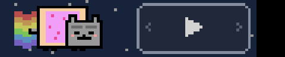

*Recorded on a real Touch Bar. The full bar looks like this (the calendar event name was replaced for privacy):*

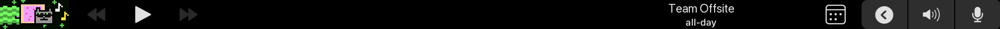

What's new in each version: [CHANGELOG.md](CHANGELOG.md).

## Variants

| | State | How it's detected |
|---|---|---|
| 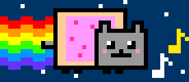 | **Music playing**: floating notes | BTT variable `BTTCurrentlyPlaying` |
| 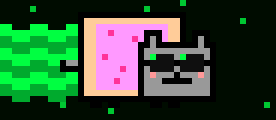 | **Terminal, editor or dev tool in front**: matrix rainbow and hacker shades | `apps.json` → `terminal` (58 apps: terminals, editors, IDEs, Git and API clients, databases) |
| 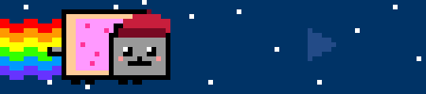 | **Design app in front**: painter's beret | `apps.json` → `diseno` (Figma, Sketch, Adobe, Affinity, Blender, Final Cut, DaVinci…), or a Penpot/Figma/Canva tab |
| 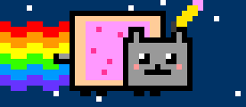 | **Writing or office app in front**: pencil behind the ear | `apps.json` → `escritura` (Notes, Pages, Word, Obsidian, Notion, Bear…), or a Google Docs tab |
| 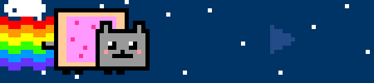 | **Chat app in front**: speech bubble, typing | `apps.json` → `chat` (Slack, Discord, WhatsApp, Telegram, Signal, Messages, Teams…) |
| 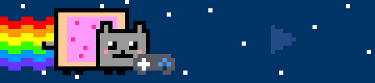 | **Game or launcher in front**: gamepad | `apps.json` → `juegos` (Steam, Epic, Battle.net, Minecraft launchers, emulators…) |
| 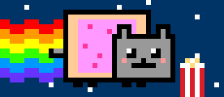 | **Watching video**: popcorn | `apps.json` → `video` (TV, IINA, VLC, Infuse…), or a YouTube/Netflix/Twitch tab |
| 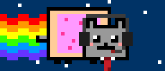 | **Camera in use**: tie | Any camera, virtual ones included, running in any app (CoreMediaIO) |
| 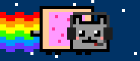 | **Microphone in use**: headset | Default input device running in any app (CoreAudio), so browser calls count too |
| 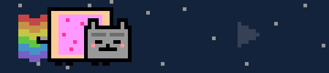 | **Battery ≤ 20 %**: faded rainbow, tired eyes | IOKit power sources |
| 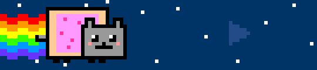 | **Charging**: lightning bolt on the pop-tart | IOKit power sources |
| 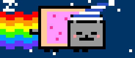 | **Midnight to 6 AM**: nightcap, closed eyes, zzz | Clock |
| 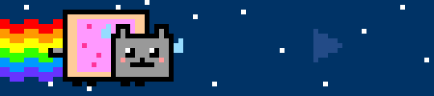 | **CPU above 70 % for 3 s**: sweat drops, double-speed animation | `host_statistics` |
| 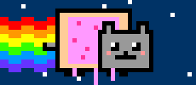 | **Mac running hot**: the frosting melts | `ProcessInfo.thermalState` serious or critical |
| 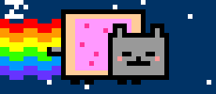 | **No keyboard or mouse for 5 min**: falls asleep, slow-motion animation | `CGEventSource` |
|  | **No network**: blinking question mark | `NWPathMonitor` |
| 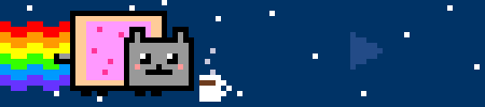 | **7 to 10 AM**: steaming coffee | Clock |
| 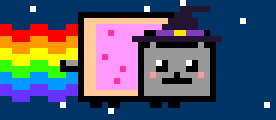 | **Special days**: witch hat (Oct 31), Santa hat (Dec 24–25), party hat and confetti (Dec 31–Jan 1), Chilean *chupalla* (Sep 18–19) | Calendar |

Accessories stack: music with a terminal in front gives you hacker shades **and** notes.

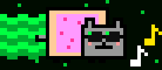

When two accessories want the same spot, a fixed priority decides (the `zonas` table in `NyanCat.swift.in`):

- Head: headset > special day > beret > pencil > nightcap
- Eyes: shades > closed (night or idle) > tired
- In front of the face: gamepad > popcorn > coffee
- Top left: zzz > speech bubble

## Media button

To the right of the cat there's one wide button that's part of the same scene: its sky, stars and button colors change along with the cat (blue and yellow normally, matrix green with a terminal in front, faded on low battery).


- **Tap:** play/pause. The button presses in and flips its icon right away, instead of waiting the second BTT takes to notice.
- **Swipe right:** next track. The ⏭ icon shoots off with a rainbow trail and the cat runs at double speed.
- **Swipe left:** previous track. The ⏮ icon shoots the other way and the cat rewinds.
- With no player, the button is a faint outline among the stars and tapping it counts as tapping the cat. With a player open, even paused (per `BTTCurrentlyPlayingApp`), it lights up.
- It sends the system media keys, like F7–F9, so it controls whatever is playing: Spotify, Music, YouTube in the browser…
- When the accessories change, a burst of pixels flies across the panel into the cat.

The widget is 135 pt wide (cat 69 + panel 66, with a 60 pt button). If your preset already has its own media buttons, you'll probably want to hide them.

## Hide a mood with a triple tap

Tap the cat (not the panel) 3 times in a row to hide the decorative moods on screen: coffee, popcorn, chat bubble and special days. They stay hidden until their next occurrence: coffee, tomorrow at 7; a special day, next year; popcorn and the bubble, the next time you open a video or chat app. The dismissal is saved in `~/Library/Application Support/NyanCat/descartados.json`, so every cat widget (BTT makes one per group) shares it, and it survives a BTT restart. Another triple tap with nothing to hide brings them back. Moods that carry information (battery, CPU, network, microphone, camera) can't be hidden.

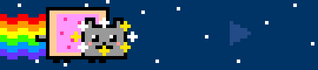

Each tap gives a light trackpad click, and the triple tap a strong one plus a burst of sparkles. The Touch Bar has no haptic engine, so the trackpad's is used through a private macOS API (the same one [HapticKey](https://github.com/niw/HapticKey) uses); if a macOS update changes it, the cat keeps working without haptics.

## Which apps trigger each mood

The app lists live in `apps.json`, sorted by mood and drawn from the most installed Homebrew casks of the last year. To change them, copy the file to `~/Library/Application Support/NyanCat/apps.json` and edit it: the plugin reloads it on save, with no BTT restart. Without that file, the copy embedded in the plugin is used.

- `apps`: exact bundle IDs, or a prefix ending in `*` (`com.jetbrains.*`). Find one with `osascript -e 'id of app "Name"'`.
- `navegadores` and `titulos`: when a browser is in front, the title of its active window is matched against these words (case-insensitive). This is how a Penpot or YouTube tab counts. It uses BTT's Accessibility permission.

## Install

You need BetterTouchTool with Swift plugin support and the Command Line Developer Tools (`xcode-select --install`). Tested on BTT 6.784 and 6.958, macOS 15.7, MacBook Pro M1 (2020).

1. Download `NyanCat.swift` from the [latest release](../../releases/latest), or grab it from this repo.
2. Copy it to `~/Library/Application Support/BetterTouchTool/Plugins/`. BTT compiles it on its own and asks you to confirm.
3. In BTT → Touch Bar, add a **Plugin** widget and pick **Nyan Cat**. Put it at the top of the list and set its placement to the left.
4. If your preset uses conditional activation groups (for example a "Music Playing" group), add the widget to those groups too.
5. When you update the plugin, restart BTT. Hot reload does not replace widgets that already exist.

## Try the variants

Force one or more states with a BTT variable (comma-separated):

```bash
osascript -e 'tell application "BetterTouchTool" to set_string_variable "nyan_forzar" to "musica,terminal"'
```

Set it back to empty to return to automatic detection:

```bash
osascript -e 'tell application "BetterTouchTool" to set_string_variable "nyan_forzar" to ""'
```

State names (in Spanish, as in the code): `musica`, `terminal`, `diseno`, `escritura`, `chat`, `juegos`, `video`, `microfono`, `videollamada`, `bateria_baja`, `cargando`, `noche`, `manana`, `inactivo`, `cpu`, `caliente`, `sin_red`, `halloween`, `navidad`, `ano_nuevo`, `fiestas_patrias`. Use `reproductor` to see the panel lit while paused. Any other value (`normal`, for example) shows the plain cat with the panel off.

## Hacking on it

The sprites are drawn in code by `generar.py` (Python 3 + Pillow). Each sprite sits on a 46×20 px grid, scaled ×3, with 12 frames per layer. The script embeds the PNG strips into `NyanCat.swift`, using `NyanCat.swift.in` as the template. Edit the template or the generator, never `NyanCat.swift` itself:

```bash
python3 generar.py
```

The stacking rules live in `NyanCat.swift.in` (`zonas`); the app lists in `apps.json`, which `generar.py` validates and embeds. The comments in the code are in Spanish.

## Performance

A 90 ms timer swaps pre-decoded frames on Core Animation layers, and the state is re-checked once per second. With the cat running, BetterTouchTool sat at about 1–2 % CPU on an M1 MacBook Pro.

## Credits

Nyan Cat is a character created by Chris Torres (2011). This is a non-commercial fan tribute with original pixel art. The code is released under the MIT license.
