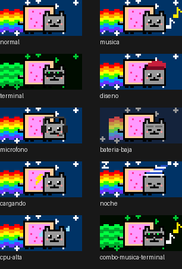

# Nyan Cat para la Touch Bar

Un Nyan Cat animado para la Touch Bar de la MacBook Pro, hecho como plugin de [BetterTouchTool](https://folivora.ai). Cambia de accesorios según lo que estés haciendo.



| Estado | Qué cambia | Cómo se detecta |
|---|---|---|
| Música sonando | Notas musicales flotando | Variable de BTT `BTTCurrentlyPlaying` |
| Terminal o editor al frente | Arcoíris matrix y lentes de hacker | App al frente (Terminal, iTerm2, Warp, Ghostty, kitty, Alacritty, VS Code, Cursor, Xcode, Zed, Sublime, PyCharm, Claude) |
| App de diseño al frente | Boina de pintor | Figma, Sketch, Photoshop, Illustrator, Pixelmator Pro, Affinity |
| Micrófono en uso | Audífonos con micrófono | Entrada de audio predeterminada en uso por cualquier app (CoreAudio) |
| Batería ≤ 20 % | Arcoíris desteñido, ojos cansados | IOKit |
| Cargando | Rayo en la tostada | IOKit |
| Entre las 0:00 y las 6:00 | Gorro de dormir, ojos cerrados, zzz | Reloj |
| CPU > 70 % por 3 s | Gotas de sudor y animación al doble de velocidad | `host_statistics` |

Los accesorios se combinan: con música y la terminal al frente, el gato sale con lentes de hacker **y** notas. Cuando dos accesorios ocupan el mismo lugar, gana uno con una prioridad fija: en la cabeza, audífonos > boina > gorro; en los ojos, lentes > dormido > cansado.

## Instalación

Requisitos: BetterTouchTool 6.7 o más nuevo y las Command Line Developer Tools (`xcode-select --install`).

1. Copia `NyanCat.swift` en `~/Library/Application Support/BetterTouchTool/Plugins/`. BTT lo compila solo y pide confirmación.
2. En BTT → Touch Bar, agrega un widget **Plugin** y elige **Nyan Cat**. Déjalo arriba de todo, con ubicación a la izquierda.
3. Si tu preset tiene grupos condicionales (por ejemplo uno de "Music Playing"), agrega el widget también en esos grupos.
4. Si ya existía una versión anterior del plugin, reinicia BTT para que cargue la nueva.

## Probar las variantes

Puedes forzar estados con una variable de BTT (separados por coma). Para volver a la detección automática, déjala vacía:

```bash
osascript -e 'tell application "BetterTouchTool" to set_string_variable "nyan_forzar" to "musica,terminal"'
```

```bash
osascript -e 'tell application "BetterTouchTool" to set_string_variable "nyan_forzar" to ""'
```

Estados: `musica`, `terminal`, `diseno`, `microfono`, `bateria_baja`, `cargando`, `noche`, `cpu`.

## Modificar

Los sprites se dibujan con código en `generar.py` (Python 3 + Pillow): grilla de 46×20 px, escala 3 y 12 cuadros por capa. El script embebe las tiras PNG en `NyanCat.swift` a partir de la plantilla `NyanCat.swift.in`. Edita la plantilla o el generador, nunca `NyanCat.swift` directamente:

```bash
python3 generar.py
```

Las listas de apps y las reglas de combinación están en `NyanCat.swift.in` (`apps` y `capasPara`).

## Consumo

Un timer de 90 ms cambia el contenido de capas ya decodificadas, y el estado se revisa una vez por segundo. En una MacBook Pro con M1, BetterTouchTool quedó en torno a 1–2 % de CPU con el gato animado.

## Créditos

Nyan Cat es un personaje creado por Chris Torres (2011). Esto es un homenaje de fans, sin fines comerciales; los sprites son pixel art propio. El código se publica bajo licencia MIT.
